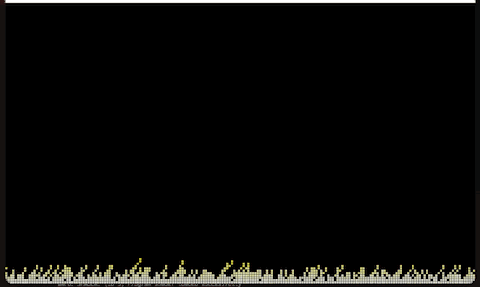

# Doom Fire Algorithm

A small fire effect written in Go with raylib. The screen is treated as a low-resolution grid of
colored cells: the bottom row is kept at the hottest color, and on every frame each cell moves one
row up while losing a bit of heat and drifting randomly left or right, which produces the flickering
flames. Run it with `go run .`.
